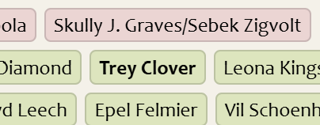

# AO3 Skins by *@frthenotebook*

A collection of AO3 site skins created over the course of time. Ranges from theming to widgets or add-ons. See [below](#previews) for previews 

{: .tip}
To install any new skin, refer to [this tutorial by AO3](https://archiveofourown.org/admin_posts/80) for guidance. To install any of my theme site skins (under `./skins/themes/`), refer to [this page](./installation.html).

{: .note}
I don't plan on creating work skins as of now, but if I were to do so, I'll update this guide with it.

## Previews

Utilities

<table>
    <tr>
        <th>Name</th>
        <th>Image</th>
        <th>Link</th>
    </tr>
    <tr>
        <td>Tag highlighting</td>
        <td>
            
        </td>
        <td>
            <a href="./skins/utilities/highlights/tag-highlights.css">
            <pre>./skins/utilities/tag-highlights.css</pre>
            </a>
        </td>
    </tr>
    <tr>
        <td>Blurb highlighting</td>
        <td>
            
        </td>
        <td>
            <a href="./skins/utilities/highlights/blurb-highlights.css">
            <pre>./skins/utilities/blurb-highlights.css</pre>
            </a>
        </td>
    </tr>
</table>

Themes

...

## Dependencies

None. It's just CSS. You might need an AO3 account to fully make use of it.

## Acknowledgements

| Resource | Note |
| --- | --- |
| [neos](https://github.com/ZerafinaCSS/neos) by ZerafinaCSS | the reason I started making skins, really |
| [Permablocking Specific Tags - Site Skin](https://archiveofourown.org/works/41214669/chapters/103324848) by Eli0t | How I became aware of the `:has()` selector. |