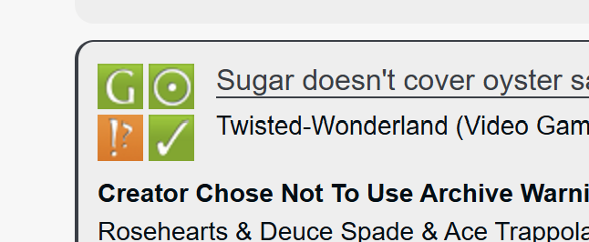

# Highlighting: A guide

The stylesheet aims to modify a property (e.g. a tag, or a blurb) given it contains specific tags or elements.

## Preamble

This code makes use of the `:has()` and `:is()` pseudo-class to only modify elements given it contains specific properties. 

This particular skin is inspired by the idea of permablocking tags (especially by the [guide](https://archiveofourown.org/works/41214669/chapters/103324848) by Eli0t)

More information on pseudo-classes here: [MDN](https://developer.mozilla.org/en-US/docs/Web/CSS/Reference/Selectors/Pseudo-classes).

## Codes

You can find the codes here:

- [`tag-highlights.css`](./tag-highlights.css)
- [`blurb-highlight.css`](./blurb-highlights.css)

### Highlighting tags

<details>
<summary>Preview</summary>


</details>
</br>

The code generally follows this format.

```css
.blurb a.tag:is(
  [href$="LINK HERE"], [href$="LINK HERE"], ...
) {
  ...
}
```

- `.blurb` represents the works you see in the search pages.
- `a` represents links, and its placement after `.blurb` means that it is a link within it. `.tag` means we're only targetting work tags.
- the `:is()` pseudo-class holds the links to the tags we want to highlight (or hide).

The last element mentioned (in this case, it's `a.tag`) will be the element modified.

The ellipses will be replaced by however you want to style the tag. Some options for reference:

```css
... {
    font-weight: bold;            /* Makes the font bold */
    color: #FF0000;             /* Makes the text red */
    background-color: grey;       /* Makes the background color grey */
    border: solid 1px #193379;  /* Creates a border around the tag */
    ...
}
```

### Highlighting Blurbs

<details>
<summary>Preview</summary>


</details>
</br>

The code is similar to when we highlight tags, but instead, we target the `.blurb` instead.

```css
.blurb:has(
    a:is(
        [href="LINK HERE"], [href$="LINK HERE"], ...
    )
) {
  ...
}
```

This time, we have the `:has()` pseudo-class to indicate ownership. In this case, `.blurb:has(...)` just means that we're only modifying `.blurbs` that have those specific links.

You can restrict it to only check tags using `.tags:is(...)` or `a.tags:is(...)` instead of `a:is(...)`.

You can play around with pseudo-classes to target specific blurbs. (I'll add more examples into the stylesheet as I figure more things out.)